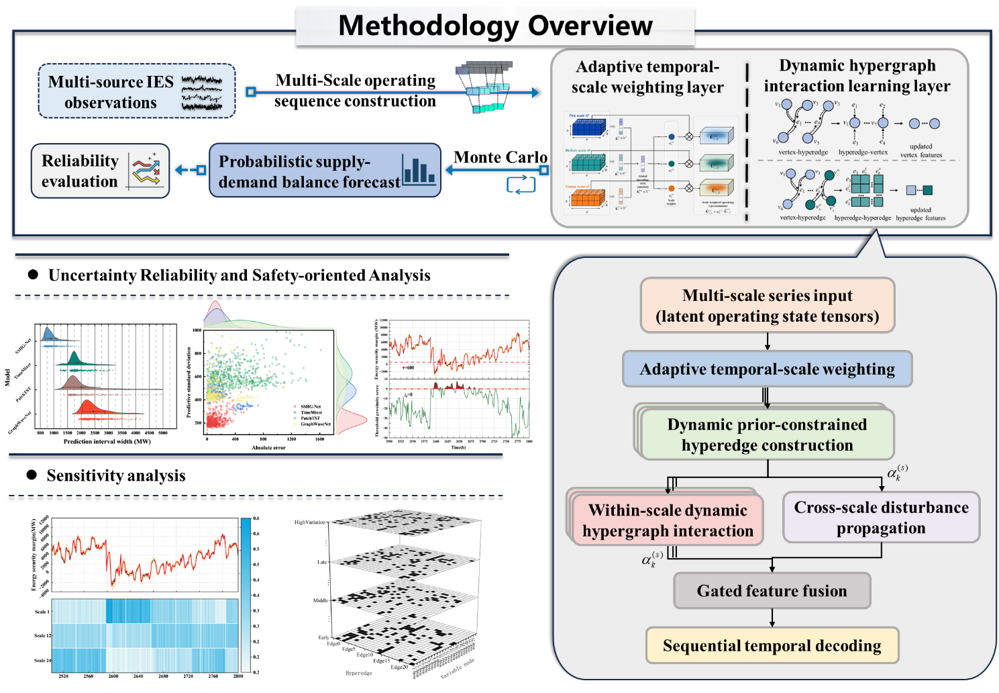
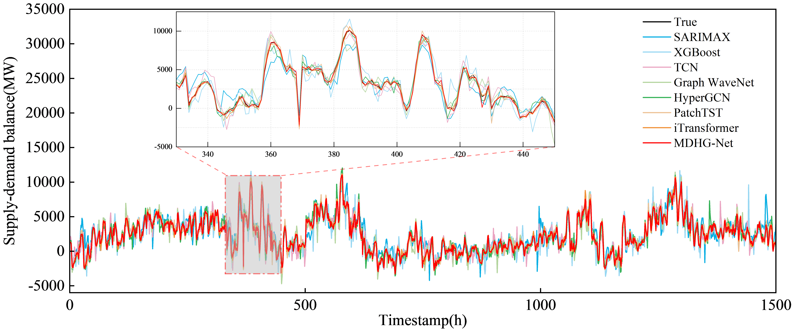
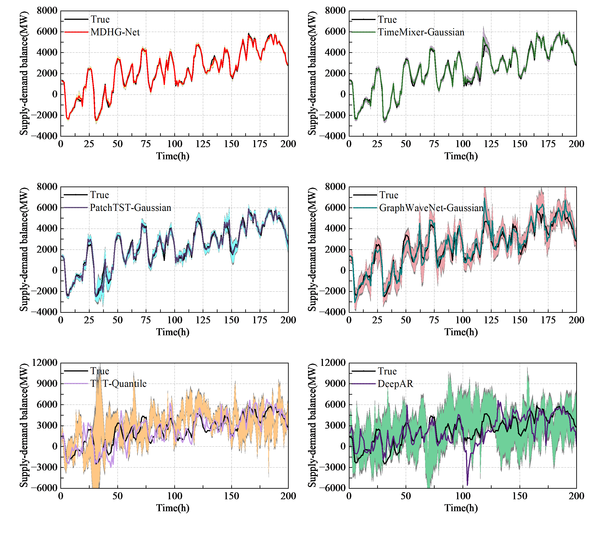

# MDHG-Net

Python 3.9 · TensorFlow 2.9.1.

MDHG-Net combines multi-scale temporal encoding, dynamic hypergraph learning, and cross-scale propagation to forecast recorded electricity generation minus actual load. A Gaussian output head and MC Dropout estimate predictive uncertainty.

## Architecture

## Results

Results reported in the manuscript, as mean ± standard deviation over five runs.

### Point Forecasting

| Model | MAE (MW) | RMSE (MW) | MAPE (%) | Corr |
| --- | --- | --- | --- | --- |
| SARIMAX | 807.24 ± 42.84 | 1164.97 ± 207.18 | 77.21 ± 9.92 | 0.881  ± 0.016 |
| XGBoost | 678.24 ± 16.97 | 915.47 ± 25.09 | 62.14 ± 9.76 | 0.928  ± 0.017 |
| TCN | 518.26 ± 11.35 | 734.70 ± 18.63 | 55.71 ± 12.31 | 0.948  ± 0.015 |
| Graph WaveNet | 427.20 ± 13.90 | 621.21 ± 23.34 | 44.00 ± 3.75 | 0.960  ± 0.013 |
| HyperGCN | 338.15 ± 7.10 | 490.00 ± 12.42 | 32.20 ± 3.69 | 0.971  ± 0.008 |
| PatchTST | 210.86 ± 6.22 | 322.78 ± 11.19 | 21.02 ± 2.63 | 0.978  ± 0.004 |
| iTransformer | 126.35 ± 1.19 | 187.72 ± 3.24 | 11.46 ± 1.47 | 0.986  ± 0.003 |
| **MDHG-Net** | **98.07 ± 1.91** | **133.81 ± 2.68** | **10.56 ± 1.76** | **0.987  ± 0.005** |

### Probabilistic Forecasting

| Model | CRPS | NLL | PICP@90 | PINAW@90 | PICP@95 | PINAW@95 | AvgSigma (MW) |
| --- | --- | --- | --- | --- | --- | --- | --- |
| DeepAR | 745.56 ± 9.82 | 8.588 ± 0.029 | 0.9533 ± 0.0205 | 0.3242 ± 0.0387 | 0.9757 ± 0.0131 | 0.3863 ± 0.0461 | 1651.77 ± 196.93 |
| TFT-Quantile | 505.52 ± 9.05 | — | 0.9627 ± 0.0023 | 0.2283 ± 0.0093 | 0.9832 ± 0.0023 | 0.2721 ± 0.0111 | — |
| GraphWaveNet-Gaussian | 321.02 ± 11.37 | 7.744 ± 0.029 | 0.9482 ± 0.0037 | 0.1434 ± 0.0105 | 0.9713 ± 0.0012 | 0.1709 ± 0.0125 | 730.48 ± 53.55 |
| PatchTST-Gaussian | 162.65 ± 9.78 | 7.009 ± 0.034 | 0.9409 ± 0.0028 | 0.0736 ± 0.0123 | 0.9651 ± 0.0035 | 0.0877 ± 0.0147 | 375.05 ± 62.71 |
| TimeMixer-Gaussian | 93.99 ± 8.15 | 6.477 ± 0.067 | 0.9238 ± 0.0108 | 0.0388 ± 0.0106 | 0.9574 ± 0.0061 | 0.0463 ± 0.0126 | 197.83 ± 53.75 |
| **MDHG-Net** | **71.25 ± 1.23** | **6.257 ± 0.024** | **0.9117 ± 0.0133** | **0.0273 ± 0.0006** | **0.9491 ± 0.0075** | **0.0326 ± 0.0008** | **139.32 ± 3.28** |

