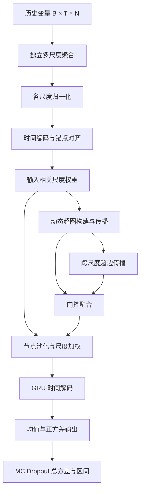

# 模块与公式对应

内部节点表示统一采用 `[B,K,N,d]`：B 为批大小，K 为时间锚点，N 为变量节点数，d 为隐维度。主模型的构造函数组装这些模块，前向函数只控制信息流。

| 独立代码文件 | 功能 | 论文公式 | 主要输出 |
| --- | --- | --- | --- |
| `modules/aggregation.py` | 各绝对窗口分别聚合；功率求和，状态平均。 | (4)–(6) | 各尺度 `[B,Ls,N]` |
| `modules/normalization.py` | 聚合后的尺度独立归一化。 | (7) | 各尺度 `[B,Ls,N]` |
| `modules/temporal_encoder.py` | 各变量共享时间卷积，粗尺度线性插值到 K。 | (8)–(10) | `[B,K,N,d]` |
| `modules/scale_weighting.py` | 节点均值池化，结合全局状态，以 excitation 和 softmax 求尺度权重。 | (11)–(15) | 权重 `[B,K,S]` |
| `modules/role_prior.py` | 生成功能角色的二值弱先验模板。 | (19) 的先验说明 | `[N,Ms]` |
| `modules/hypergraph_construction.py` | 原型相似度、角色先验门控、softmax 与阈值稀疏化。 | (17)–(22) | `[B,K,N,Ms]` |
| `modules/hypergraph_convolution.py` | 度规范化与节点–超边–节点传播，生成本尺度表示及超边表示。 | (22)–(25) | `[B,K,N,d]`、`[B,K,Ms,d]` |
| `modules/dynamic_hypergraph.py` | 组合隶属构建和超图卷积。 | (17)–(25) | 本尺度结构表示及诊断 |
| `modules/cross_scale_propagation.py` | 同一锚点不同尺度的超边注意力交换，映射回节点。 | (26)–(29) | `[B,K,N,d]` |
| `modules/gated_fusion.py` | 门控融合本尺度与跨尺度节点表示。 | (30)–(31) | `[B,K,N,d]` |
| `modules/scale_fusion.py` | 节点池化与尺度加权，形成时间有序序列。 | (32)–(34) | `[B,K,d]` |
| `modules/temporal_decoder.py` | GRU 顺序解码，并对最终状态施加 dropout。 | (35)–(36) | `[B,gru_hidden]` |
| `modules/probabilistic_head.py` | 单一均值头与 softplus 正方差头。 | (37)–(39) | `mu/variance/sigma: [B,H,1]` |
| `modules/pairwise_graph.py` | 普通节点注意力，供成对交互消融使用。 | 消融定义 | `[B,K,N,d]` |
| `losses/gaussian_nll.py` | 以方差为参数的 Gaussian NLL。 | (43)–(44) | 标量损失 |
| `inference/mc_dropout.py` | MC 推理、总方差、区间和可选量纲还原。 | (40)–(42) | 总预测分布的矩 |

表中路径均相对于 `mdhg_net/`。各模块可从 `mdhg_net.modules` 单独导入，方便后续修改或做消融。

## 保持的模型约定

尺度窗口是绝对长度，不转换为连续下采样倍率；粗尺度先在原始输入上独立构建，然后编码与插值。因此 `[1,12,24,48,72]` 不需要相邻尺度成倍数。

不足整窗口时，只在输入历史的最旧端补零。功率通道的单位在求和后对应累计能量；状态变量按完整窗口长度求平均，归一化发生在聚合之后。模型不读取未来数据。

尺度权重既在结构学习前调制表示，也在最终尺度汇总时使用。动态隶属矩阵逐样本、逐时间锚点生成；按阈值保留软值，不使用 top-k，也不在稀疏化后再次强制行和为一。孤立节点与空超边的逆度为零，避免除零。

跨尺度注意力在不同尺度的超边表示之间计算；GRU 的输入沿对齐后的时间轴排列。点预测就是 Gaussian 的预测均值，概率头输出的 softplus 量是方差。

## 明确的实现选择与范围

论文未完整给出 Norm、卷积层数和核长、候选超边数、超边权重初始化或 dropout 位置。本实现使用尺度独立 LayerNorm、两层核长 3 且 stride=1 的共享时间卷积、每尺度 6 个候选超边，以及编码器/结构输出/最终解码状态中的显式 Dropout。调用方也可提供训练阶段确定的尺度均值与标准差。式 (23) 的 Wh 现以完整 Ms×Ms 可学习矩阵实现，单位矩阵初始化是本实现的选择。

默认列名共有 24 个非目标输入变量，含 17 个功率变量与 7 个气象变量；文稿中“23 个变量、18+5”的描述与该配置不同。市场角色模板为空，动态机制可以学习该候选超边的成员。角色先验表示弱统计分组，不表示物理网络拓扑。

训练没有附加 MSE、超边约束、尺度均衡或强制动态性奖励。默认配置的数值与主要实验设置见 `configs/default.json`。各消融是明确的实现方案；没有完整数据训练结果时，不能将其等同于文稿表格的实验数值。

`training/checkpoint.py` 处理前一版生成包的参数名，并把旧的正对角超边权重转换为对应的对角矩阵。本版的 `load_model()` 可以加载前一版生成包保存的同配置权重；最初桌面工程中的另一种 ASHyper 架构权重不适用。新增的完整矩阵参数会在继续训练时学习非对角元素，不能声称新训练轨迹与旧版相同。

GitHub 自动测试使用官方发布的 [actions/checkout v7.0.1](https://github.com/actions/checkout/releases/tag/v7.0.1) 和 [actions/setup-python v7.0.0](https://github.com/actions/setup-python/releases/tag/v7.0.0)。实际云端执行应以上传后的 Actions 日志为准。
